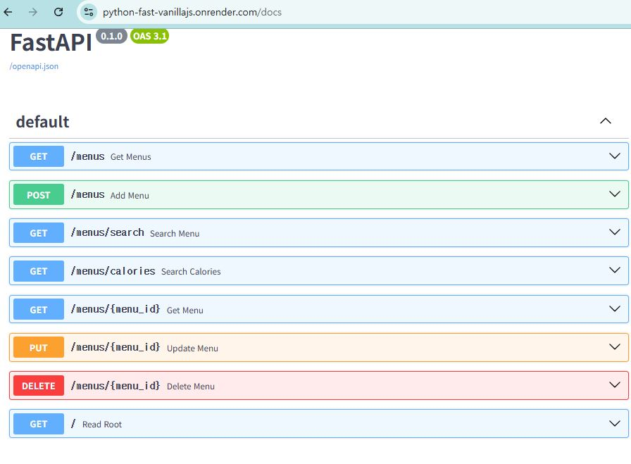

# 🍽️ 음식 메뉴 관리 시스템 (Food Menu Management System)

HTML, CSS, Vanilla JavaScript와 FastAPI를 활용하여 만든 가벼운 웹 기반 **음식 메뉴 관리 시스템**입니다. 메모리 배열(In-Memory Array)을 데이터베이스 대용으로 사용하여 간단하고 빠르게 동작합니다.

---

## 🛠️ Tech Stack

### Frontend

- **HTML5 / CSS3**
- **Vanilla JavaScript** (ES6 Modules, `onclick` & Event Binding)

### Backend

- **Python 3.10+**
- **FastAPI** (`0.110.0`)
- **Uvicorn** (`0.28.0`)
- **Pydantic** (`2.6.4`)

### Database

- **In-Memory Array** (파이썬 리스트 구조)

### Deployment

- **Render** (Web Service)

---

## ✨ Key Features

1. **홈 화면 (랜덤 추천)**
   - 등록된 메뉴 중 랜덤으로 3가지를 골라 오늘의 추천 메뉴로 보여줍니다.
2. **전체 메뉴 조회 및 검색**
   - 등록된 모든 메뉴를 테이블 형태로 확인하고, 실시간 검색어로 원하는 메뉴를 찾을 수 있습니다.
3. **메뉴 등록 / 수정 / 삭제**
   - 새로운 메뉴를 등록하고, 모달 창을 통해 기존 메뉴 정보를 수정하거나 삭제할 수 있습니다.

---

## 📂 Project Structure

```text
📦 your-repo-name
 ┣ 📜 index.html          # 프론트엔드 UI 및 Vanilla JS 스크립트
 ┣ 📂 storage
 ┃ ┗ 📜 data.js           # API 통신 모듈
 ┣ 📜 main.py             # FastAPI 백엔드 서버
 ┗ 📜 requirements.txt    # 파이썬 패키지 의존성 목록
```

